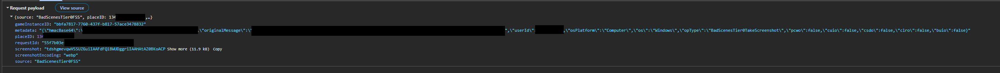

# Screenshot Uploading
Turns out.. Roblox uploads screenshots of your game every few minutes using this endpoint ``https://apis.roblox.com/rm3-evidence-filter/v1/upload-screenshot``

## But.. why?
My guess is that its supposed to be used to catch 18+ games and exploiters, Cuz I dont see any other use of that type of telemetry.

## What does it upload?
On this image you can see what it does upload to roblox:

And infact, judging by the "BadScenes" info, I suppose my theory is correct.
Also yes screenshot key is infact a webp screenshot of your game!

## Wow so invasive
Yes i agree with that, the amount of metadata it uploads is just... wow. 
I do not quite understand what it means by "pcwo", "cuio", "csdo", "clro" and "buio".

## The end
Anyway I think I've covered enough for now, Might do some updates if I find anything else related to this. Cya!
